# NHẬT KÝ NGHIÊN CỨU VÀ MINH CHỨNG DỮ LIỆU GỐC

**DỰ ÁN:** ADAPTIVE MATH - HỆ THỐNG HỌC TOÁN THÍCH ỨNG ỨNG DỤNG LÝ THUYẾT ỨNG ĐÁP CÂU HỎI (IRT) VÀ TRUY VẾT TRI THỨC BAYES (BKT) CÁ NHÂN HOÁ LỘ TRÌNH ÔN LUYỆN CHO HỌC SINH TRUNG HỌC CƠ SỞ  
**LĨNH VỰC:** CÔNG NGHỆ THÔNG TIN  
**NGƯỜI THỰC HIỆN:** NGUYỄN NAM PHONG + PHAN TRANG NHUNG  
**GIÁO VIÊN HƯỚNG DẪN:** BAN CỐ VẤN CHUYÊN MÔN TOÁN & CNTT  
**CẬP NHẬT ĐỐI CHIẾU:** 19/10/2026  

> **Lưu ý đối chiếu (19/10/2026):** Nội dung kỹ thuật được sửa theo phiên bản hiện tại; ngày thực hiện và phân công lịch sử giữ theo bản gốc, không được xác minh lại. *"Hoàn thành"* chỉ áp dụng khi có bằng chứng tương ứng; QA và mô phỏng không thay cho thực nghiệm học sinh.

---

## I. BẢNG TIẾN TRÌNH 8 GIAI ĐOẠN NGHIÊN CỨU & ĐỐI CHIẾU KỸ THUẬT

| Giai đoạn | Mục tiêu kỹ thuật | Công việc đã thực hiện | Vai trò thành viên | Khó khăn phát sinh | Cách giải quyết | Kết quả đạt được | Minh chứng kỹ thuật | Trạng thái |
| :--- | :--- | :--- | :--- | :--- | :--- | :--- | :--- | :--- |
| **GĐ 1** *(02/7/2026 – 10/7/2026)* | Đối chiếu học liệu và nhãn câu hỏi. | Kho JSON gốc có 1.472 câu. Ngân hàng xét chọn ngày 19/10/2026 có 555 câu đủ điều kiện trạng thái/nguồn; đủ 22 vị trí nhưng một số vị trí chỉ có một biến thể. | Trang Nhung: Phân loại học liệu. Nam Phong: Cấu trúc JSON. | Khác nhau giữa học liệu gốc và ngân hàng dùng được; nhãn độ khó chưa hiệu chuẩn. | Ghi rõ nguồn dữ liệu, loại câu, nhãn và trạng thái rà soát. | Đã xác minh số bản ghi nguồn và hồ sơ ngân hàng; chưa xác nhận đủ 92 lý thuyết/9 nhiệm vụ số đang chạy. | [MC01](#mc01-giai-đoạn-1-ngân-hàng-câu-hỏi); `content/math/legacy-bank.json`; hồ sơ `diagnostic-completion-2026-10-19`. *(Nguồn đối chiếu: https://me-l.co/26nuyybr)* | **ĐÃ ĐỐI CHIẾU; CÒN RÀ SOÁT NỘI DUNG** |
| **GĐ 2** *(11/7/2026 – 20/7/2026)* | Đối chiếu kiến trúc và quyền truy cập. | React/Vite → API NestJS → PostgreSQL/Prisma. Phiên máy chủ, cookie HttpOnly, mật khẩu Argon2id. | Nam Phong: Kiến trúc hệ thống. Trang Nhung: Kiểm tra phân quyền. | Bản cũ mô tả Firebase/offline; chính sách giáo viên hiện tự động duyệt đăng ký. | Sửa mô tả theo mã; tách kiểm thử quyền khỏi khẳng định bảo mật tuyệt đối. | Có lưu và khôi phục qua API. Chưa xác nhận học đầy đủ khi mất mạng hoặc thẩm định giáo viên thủ công. | [MC02](#mc02-giai-đoạn-2-cấu-trúc-dữ-liệu), [MC10](#mc10-giao-diện-ứng-dụng-đang-công-khai); `package.json`; `schema.prisma`; `auth.service.ts`; `classroom.service.ts`. *(Nguồn: https://me-l.co/518pqzgq)* | **ĐÃ ĐỐI CHIẾU MÃ** |
| **GĐ 3** *(21/7/2026 – 31/7/2026)* | Đối chiếu đầu vào và ước lượng năng lực. | Đầu vào Toán 9 cố định 22 vị trí: 12 lựa chọn, 4 đúng/sai, 6 ngắn. MAP dùng prior $\mathcal{N}(0, 4)$, bước $\pm 0,75$, $\theta \in [-4, 4]$. | Trang Nhung: Thuật toán IRT. Nam Phong: Kiểm tra mô hình. | CAT bậc thang trong mô phỏng khác bộ ghép đề hiện tại; thiếu ma trận phải từ chối. | Giữ đề và bản nháp trên máy chủ; tách mô tả CAT nghiên cứu khỏi phiên đầu vào. | 11 kiểm thử lõi/ma trận đạt trong lần đối chiếu; 17 kiểm thử loại câu/nhãn đạt. Không khẳng định mọi trường hợp hội tụ. | [MC03](#mc03-giai-đoạn-3-irt-3pl-và-map), [MC04](#mc04-giai-đoạn-3-bộ-chọn-câu-hỏi-cat); `diagnostic.service.ts`; `diagnostic-blueprint.ts`; kết quả 28 kiểm thử. *(Nguồn: https://me-l.co/3ws3m2lk)* | **ĐÃ ĐỐI CHIẾU VÀ KIỂM THỬ ĐƠN VỊ** |
| **GĐ 4** *(01/8/2026 – 10/8/2026)* | Đối chiếu BKT và bằng chứng năng lực. | $p(T)=0,15$; $p(G)=0,25$; $p(S)=0,10$. Phiên luyện lấy mức nắm vững hiện có, mặc định $0,10$. | Nam Phong: Mô hình BKT. Trang Nhung: Tính hậu nghiệm. | Ba câu đúng có thể vượt $0,85$ nhưng chưa đủ bằng chứng để kết luận thành thạo. | Yêu cầu $\ge 5$ câu bằng chứng và ngưỡng theo mục tiêu; khởi động/câu cũ đúng không làm tăng bằng chứng. | Ví dụ tổng hợp từ $0,10$ qua ba câu đúng đạt khoảng $0,9261$. Đây là kiểm tra công thức, không phải tiến bộ học sinh thật. | [MC05](#mc05-giai-đoạn-4-truy-vết-tri-thức-bkt); `math-adaptive.ts`; `math-practice.service.ts`; `student.service.ts`. *(Nguồn: https://me-l.co/f0zjc6du)* | **ĐÃ ĐỐI CHIẾU MÃ** |
| **GĐ 5** *(11/8/2026 – 20/8/2026)* | Đối chiếu lộ trình, luyện tập và lịch ôn. | Xếp lịch theo thiếu hụt mục tiêu và số bằng chứng; tối đa 2 kỹ năng/ngày, $\le 90$ ngày; phiên luyện tối đa 9 câu và ba pha. | Trang Nhung: Lộ trình & lịch ôn. Nam Phong: Sổ lỗi & ghi nhớ. | Nhật ký cũ dùng SM-2 và chuỗi ngày ôn cố định; hệ thống đang dùng FSRS. | Thay bằng FSRS: retention $0,90$, fuzz tắt, khoảng tối đa 365 ngày; sai buộc Again. | Có ôn đến hạn và cập nhật sổ lỗi; chưa có đo mức ghi nhớ trên học sinh thật. Không dùng lịch 1, 4, 12, 34, 98 làm kết quả hiện tại. | [MC06](#mc06-giai-đoạn-5-sinh-lộ-trình-học), [MC07](#mc07-giai-đoạn-5-giao-diện-lộ-trình), [MC08](#mc08-giai-đoạn-5-giao-diện-bài-học-và-luyện-tập); `math-review.service.ts`; `math-practice.service.ts`; `buildStudyPlan`. *(Nguồn: https://me-l.co/nd7l8yy6)* | **ĐÃ ĐỐI CHIẾU MÃ** |
| **GĐ 6** *(21/8/2026 – 31/8/2026)* | Đối chiếu chỉnh độ khó và cây tri thức. | Phần luyện có $b^*=\theta+\Delta$: hai sai $-0,5$; hai đúng $+0,8$; khác $+0,3$; khởi động $b=-1,5$. Bổ sung bản cây minh họa độc lập từ $p(L)$. | Nam Phong: Điều chỉnh độ khó & cây tri thức. | Chưa có nhánh flow $+0,4$, nhận diện tâm lý theo thời gian/bỏ qua hoặc cây sáu thành phần trong mã đối chiếu. | Mô tả đúng quy tắc đang có; ghi cây là đề xuất, không dùng ảnh hồ sơ năng lực chứng minh cây. | Đã có quy tắc thích ứng đơn giản. Cây bốn giai đoạn chưa tích hợp; chưa xác nhận công thức ổn định sáu thành phần hoặc hiệu ứng chuyển cảnh. | [MC09](#mc09-giai-đoạn-6-giao-diện-hồ-sơ-năng-lực), [MC11](#mc11-bổ-sung-đối-chiếu-giai-đoạn-6); `MathPracticeService.next`; `outputs/minh-chung-6`. *(Nguồn: https://me-l.co/ijx4a3up)* | **ĐẠT MỘT PHẦN; CÂY LÀ ĐỀ XUẤT** |
| **GĐ 7** *(01/9/2026 – 10/9/2026)* | Kiểm chứng mô phỏng và dữ liệu đầu ra. | Bộ JavaScript ngày 17/10/2026: seed 20261016, 1.500 học sinh ảo, 8 kỹ năng, 256 câu, tối đa 24 mốc; ba chiến lược. | *(Nhật ký gốc chưa ghi phân công giai đoạn này)* | Một seed và ngân hàng tổng hợp; mốc sau có thể giữ ước lượng cuối khi hết kỹ năng. Mô phỏng không đánh giá đề 22 câu mới. | Tính lại RMSE/chạm biên từ 108.000 dòng; kiểm tra nguồn `math-adaptive.ts` kèm theo trùng mã hiện tại. | Mốc 20: RMSE MAP $0,557594$; MLE $0,739603$; Fisher MAP $0,512840$. Chạm biên MLE $4,2667\%$, MAP $0\%$. Thay chỉ số $59,7\%$ cũ bằng $61,3333\%$ tại mốc 4. | [MC12](#mc12-bổ-sung-dữ-liệu-mô-phỏng-giai-đoạn-7); `outputs/minh-chung-7`: mã, cấu hình, CSV, JSON, biểu đồ. *(Nguồn: https://me-l.co/677zb9v9)* | **ĐÃ KIỂM TRA LẠI DỮ LIỆU MÔ PHỎNG** |
| **GĐ 8** *(11/9/2026 – 20/9/2026)* | Chuẩn bị thực nghiệm sư phạm. | Kế hoạch hai nhóm, kiểm tra trước–sau, khoảng 30 phút/ngày trong 4 tuần; chưa xác nhận đã tổ chức. | Trang Nhung: Thiết kế hai nhóm. Nam Phong: Thiết kế bài kiểm tra & phân tích. | Chưa có điểm trước–sau mã hóa danh tính, bài làm, ảnh/video tổ chức và dữ liệu phân tích thật. | Giữ là kế hoạch; bổ sung dữ liệu gốc trước khi tính mức tăng, giá trị p và Cohen’s d. | Chưa đủ dữ liệu kết luận hiệu quả sư phạm. Không dùng lớp mô phỏng, tài khoản QA hoặc 1.500 học sinh ảo làm người tham gia. | Cần ảnh trước/sau, buổi học, hai nhóm; bài làm và nhật ký tương ứng. | **CHƯA XÁC NHẬN THỰC NGHIỆM** |

---

## II. HỒ SƠ MINH CHỨNG DỮ LIỆU GỐC (MC01 – MC12)

### MC01: Giai đoạn 1 – Ngân hàng câu hỏi
> **Mô tả:** Ảnh trích dữ liệu tạo lại ngày 19/10/2026 từ kho JSON gốc, gồm tổng số và một câu ví dụ. Không xác nhận đây là số câu đã xuất bản trên máy chủ.

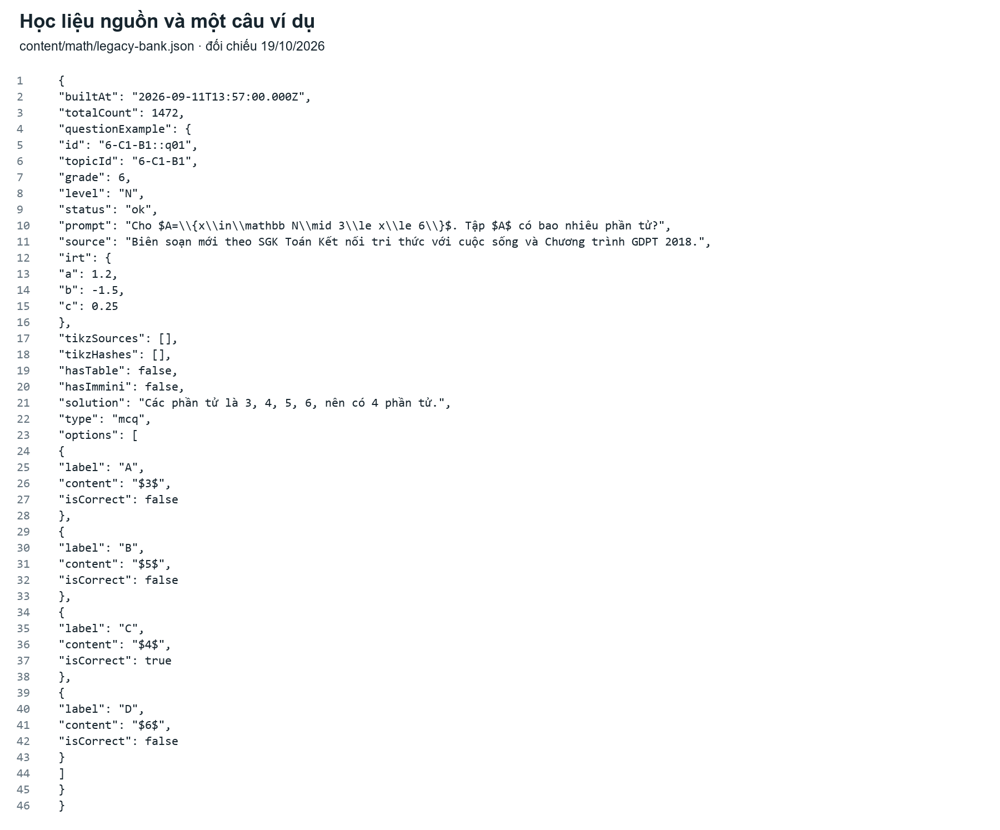

---

### MC02: Giai đoạn 2 – Cấu trúc dữ liệu
> **Mô tả:** Ảnh trích schema tạo lại ngày 19/10/2026; cấu hình PostgreSQL qua Prisma. Đây là minh chứng mã nguồn, không phải ảnh dữ liệu học sinh.

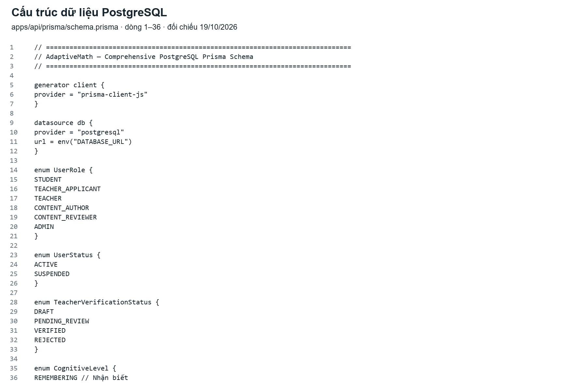

---

### MC03: Giai đoạn 3 – IRT 3PL và MAP
> **Mô tả:** Ảnh trích mã hiện tại ngày 19/10/2026: xác suất 3PL, thông tin Fisher, điểm phần và MAP có bước giới hạn.

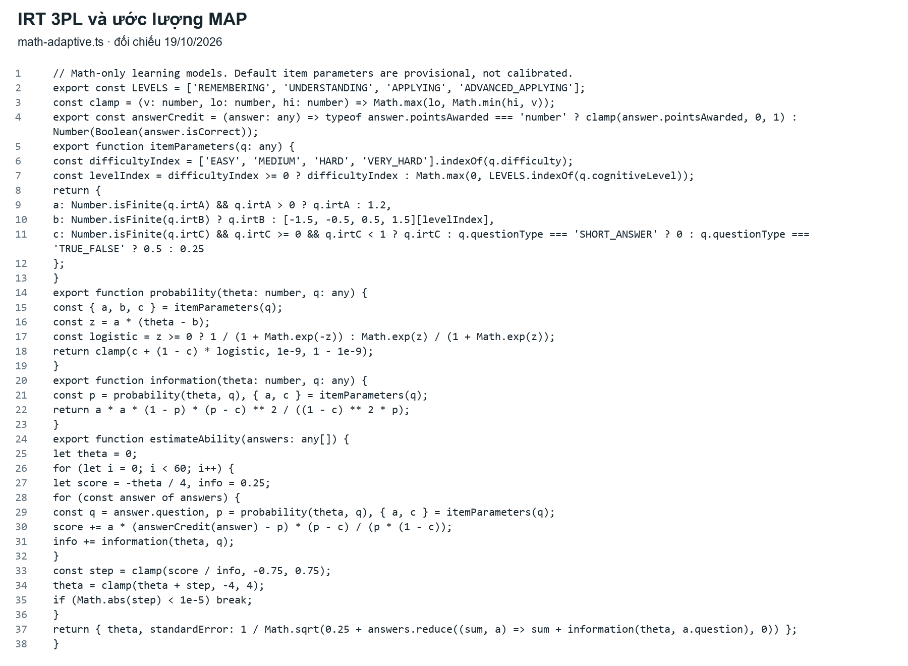

---

### MC04: Giai đoạn 3 – Bộ chọn câu hỏi CAT
> **Mô tả:** Ảnh trích hàm CAT bậc thang ngày 19/10/2026. Hàm được dùng trong bộ nghiên cứu/mô phỏng; đầu vào 22 câu hiện dùng ma trận cố định trong phiên.

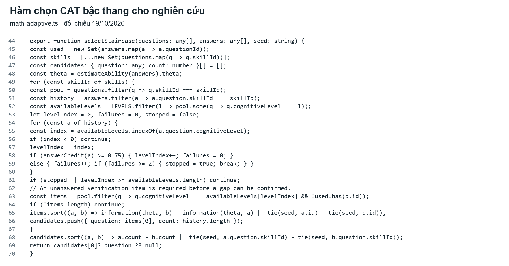

---

### MC05: Giai đoạn 4 – Truy vết tri thức BKT
> **Mô tả:** Ảnh trích `diagnosticMastery` và `updateKnowledge` ngày 19/10/2026. Kỹ năng chưa đánh giá trả `null`; điểm phần được dùng trong mức nắm vững.

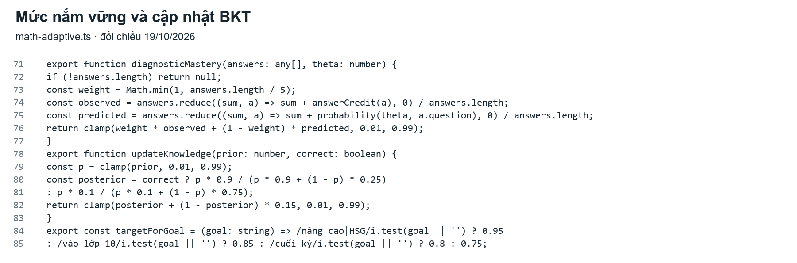

---

### MC06: Giai đoạn 5 – Sinh lộ trình học
> **Mô tả:** Ảnh trích mã `buildStudyPlan` được tạo lại ngày 19/10/2026 để thay ảnh cũ bị bó chiều ngang. Nội dung lấy trực tiếp từ `math-adaptive.ts`; lịch ôn hiện dùng FSRS, không xác nhận chuỗi SM-2 trong nguyên mẫu.

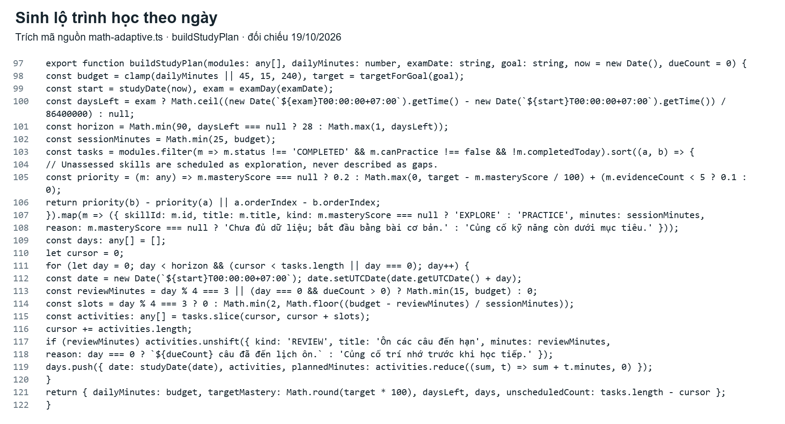

---

### MC07: Giai đoạn 5 – Giao diện lộ trình
> **Mô tả:** Ảnh kiểm thử giao diện đã lưu trong dự án, sử dụng môi trường QA và câu hỏi kiểm thử. Không phải dữ liệu thực nghiệm học sinh. Ảnh lưu từ hồ sơ cũ, không phải ảnh chụp mới trong lần đối chiếu 19/10/2026.

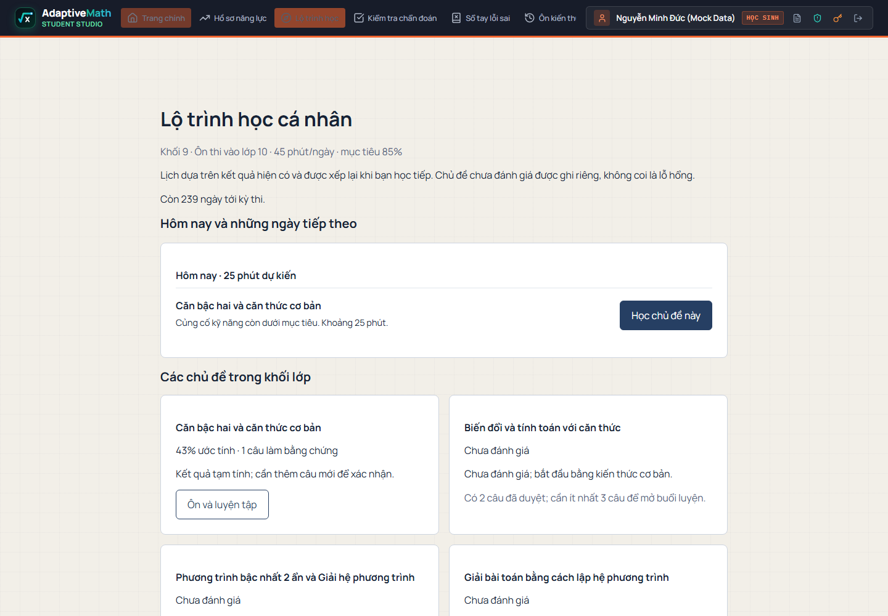

---

### MC08: Giai đoạn 5 – Giao diện bài học và luyện tập
> **Mô tả:** Ảnh kiểm thử đã lưu trong dự án, minh họa nội dung bài học và pha luyện tập. Không phải ảnh học sinh tham gia nghiên cứu. Ảnh lưu từ hồ sơ cũ, không phải ảnh chụp mới trong lần đối chiếu 19/10/2026.

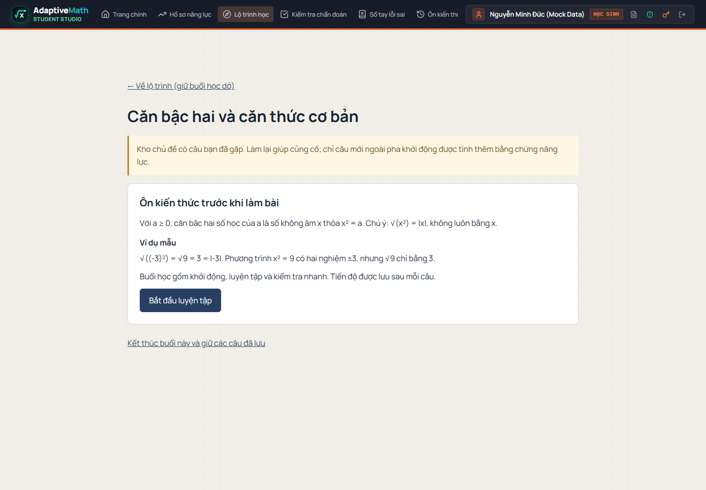

---

### MC09: Giai đoạn 6 – Giao diện hồ sơ năng lực
> **Mô tả:** Ảnh hồ sơ năng lực từ hồ sơ QA `math-radar-redesign`, thay ảnh cũ có độ tương phản thấp. Minh họa biểu đồ kỹ năng và dữ liệu thử; không xác nhận cây tri thức, trạng thái tâm lý hoặc tiến bộ học sinh thật. Không phải ảnh chụp production mới trong lần đối chiếu.

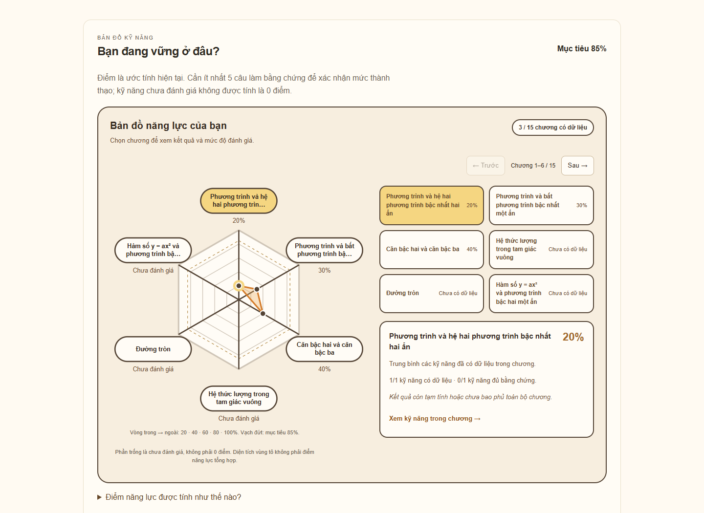

---

### MC10: Giao diện ứng dụng đang công khai
> **Mô tả:** Ảnh chụp trang ứng dụng https://adaptivemath-blush.vercel.app ngày 15/10/2026. Chỉ xác nhận giao diện công khai tại thời điểm chụp. Ảnh lưu từ hồ sơ cũ, không phải ảnh chụp mới trong lần đối chiếu 19/10/2026.

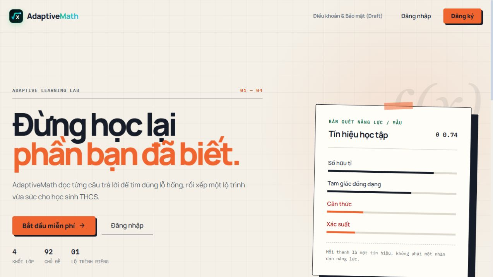

---

### MC11: Bổ sung đối chiếu Giai đoạn 6
> **Mô tả:** Quy tắc chỉnh độ khó đã có trong mã luyện tập; bản cây dưới đây là đề xuất độc lập, chưa tích hợp. Phần kiểm tra trước đó chỉ xem `math-adaptive.ts` là chưa đầy đủ; đối chiếu này đã kiểm tra thêm `math-practice.service.ts`.
> *Nguồn sơ đồ: `MathPracticeService.next`, mã đối chiếu 19/10/2026. Thời gian và tỷ lệ bỏ qua chưa được dùng để nhận diện trạng thái tâm lý.*

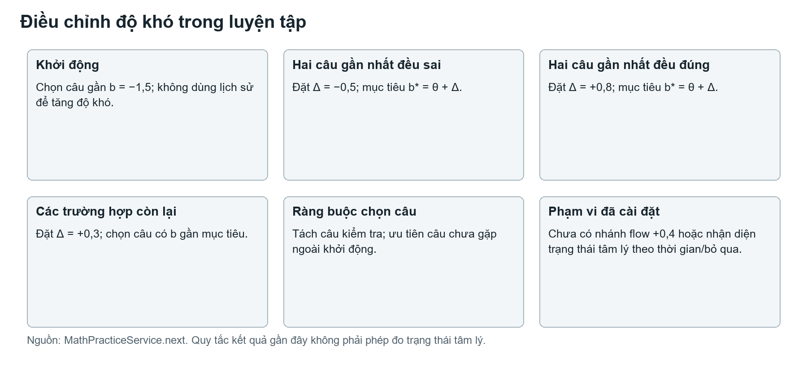

---

### MC11b: Cây tri thức minh họa đề xuất
> **Mô tả:** Cây minh họa bốn giai đoạn từ $p(L)$; ngưỡng phục vụ trình bày, chưa hiệu chuẩn và chưa phải giao diện vận hành.

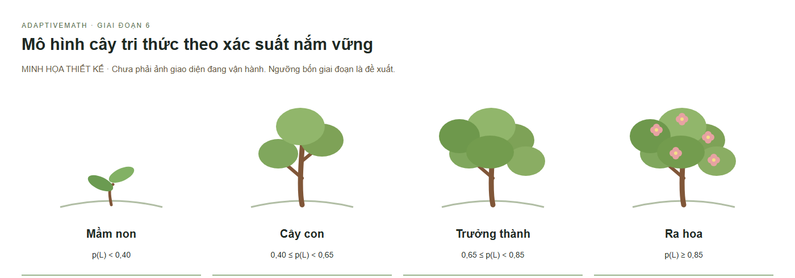

---

### MC12: Bổ sung dữ liệu mô phỏng Giai đoạn 7
> **Mô tả:** Đã tính lại 108.000 bản ghi; đủ 1.500 học sinh ảo ở từng mốc của từng chiến lược. Bản `math-adaptive.ts` kèm mô phỏng trùng nguồn đối chiếu. Mô phỏng ngày 17/10/2026, seed 20261016; không phải đợt thực nghiệm với người học.
> *Tại mốc 20: RMSE lần lượt $0,557594$; $0,739603$; $0,512840$. Chạm biên MLE $4,2667\%$; hai nhánh MAP $0\%$. Nếu hết kỹ năng đủ điều kiện, giữ $\theta$ cuối cho mốc tiếp theo; chưa dùng kết quả này để xác nhận đề 22 câu hiện tại.*

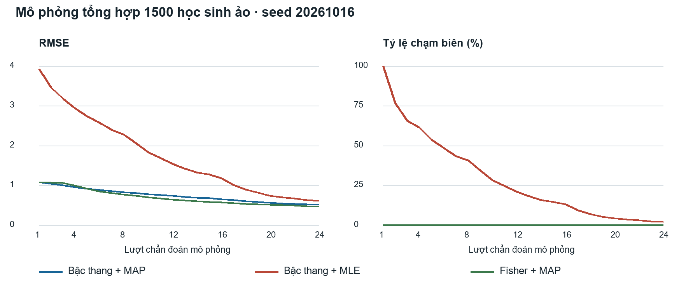

---

## III. MINH CHỨNG CẦN BỔ SUNG TRONG THỜI GIAN TỚI

1. **Giai đoạn 7:** Đã bổ sung mã mô phỏng, cấu hình, CSV 108.000 dòng, JSON và biểu đồ trong `outputs/minh-chung-7`; đã kiểm tra lại các tổng hợp. Chưa có xác nhận độc lập nhiều seed hoặc kết quả học sinh thật.
2. **Giai đoạn 6:** Có chỉnh độ khó đơn giản trong `math-practice.service.ts`; cây bốn giai đoạn chỉ là minh họa độc lập. Còn thiếu triển khai cây và kiểm chứng công thức sáu thành phần nếu tiếp tục sử dụng thiết kế đó.
3. **Giai đoạn 8 (Thực nghiệm sư phạm):**
   - Ảnh học sinh làm bài kiểm tra đầu vào, có bối cảnh tổ chức và thời điểm thực hiện.
   - Ảnh học sinh sử dụng AdaptiveMath trong buổi học thực nghiệm; video thao tác thực tế.
   - Ảnh học sinh làm bài kiểm tra sau thực nghiệm; ảnh hoạt động của nhóm đối chứng và nhóm thực nghiệm.
   - Bổ sung bài làm, bảng điểm trước/sau đã mã hóa danh tính, nhật ký học và dữ liệu phân tích gốc tương ứng.

---

## IV. BẢN GỐC ĐÍNH KÈM
- Tài liệu Word gốc có chữ ký và biên bản đối chiếu: [`docs/Nhat_ky_minh_chung_da_doi_chieu_1.docx`](Nhat_ky_minh_chung_da_doi_chieu_1.docx)
- Thư mục ảnh minh chứng độ phân giải cao: [`docs/minh-chung/`](docs/minh-chung/)
