**Lĩnh vực:** Công nghệ thông tin (đơn vị dự thi xác nhận tên lĩnh vực theo danh mục của Sở).

# MỤC LỤC

- Tóm tắt
- 1\. Vì sao nhóm chọn đề tài này
    - 1.1. Vấn đề trong lớp học
    - 1.2. Khảo sát ban đầu
    - 1.3. Mục tiêu và câu hỏi nghiên cứu
- 2\. Sản phẩm làm được gì
- 3\. Cách phần mềm tính toán
    - 3.1. Dữ liệu học liệu
    - 3.2. Ước lượng năng lực bằng IRT
    - 3.3. Chọn câu hỏi theo bậc thang
    - 3.4. Theo dõi mức nắm vững bằng BKT
    - 3.5. Xếp lộ trình và lịch ôn
    - 3.6. Gia sư AI
    - 3.7. Lưu trữ và bảo vệ dữ liệu
- 4\. Kết quả kiểm tra
    - 4.1. Mô phỏng bài kiểm tra đầu vào
    - 4.2. Chạy thử giao diện
    - 4.3. Gia sư AI
    - 4.4. Thử nghiệm với học sinh
- 5\. Hạn chế
- 6\. Kết luận và hướng phát triển
- Tài liệu tham khảo
- Phụ lục: minh chứng và thông tin truy cập

# Tóm tắt

Trong một lớp 40 học sinh, có bạn đã vững phân số, có bạn vẫn quy đồng sai. Bài tập giao chung cho cả lớp thường quá dễ với nhóm này và quá khó với nhóm kia. Nhóm muốn làm một trang web giúp mỗi học sinh THCS biết mình đang hổng ở chủ đề nào và nên học gì trước.

AdaptiveMath chạy trên trình duyệt, bám Chương trình GDPT 2018[^gdpt] và bộ sách *Kết nối tri thức với cuộc sống* lớp 6–9. Học sinh làm bài kiểm tra đầu vào theo từng chương. Câu hỏi được chọn theo bậc Nhận biết → Thông hiểu → Vận dụng → Vận dụng cao. Mô hình IRT[^irt] ba tham số ước lượng năng lực θ[^theta], còn mô hình BKT[^bkt] theo dõi mức nắm vững từng chủ đề qua mỗi câu trả lời. Từ đó phần mềm xếp lộ trình theo ngày, ghi sổ lỗi sai, hẹn lịch ôn theo thuật toán SM-2[^sm2] và có Gia sư AI (Google Gemini) chỉ gợi ý từng bước chứ không làm bài thay.

Kho dữ liệu hiện có 1.472 câu trắc nghiệm gắn nhãn mức độ cho 92 chủ đề, 92 bài lý thuyết và 3.783 bài tập tự luyện. Nhóm mô phỏng 1.000 học sinh ảo cho mỗi khối lớp bằng chính mã nguồn của phần mềm. Khi làm đủ các chương, sai số ước lượng năng lực (RMSE[^rmse]) nằm trong khoảng 0,23–0,35. Nếu mới làm một chương, sai số là 0,57–0,79. Đây là kết quả mô phỏng, chưa phải kết quả trên học sinh thật. Thử nghiệm với lớp học là việc nhóm sẽ làm tiếp, sau khi được nhà trường cho phép.

Kết quả thử nghiệm với học sinh (nếu có): ……………………………………………………………………

**Từ khóa:** học tập thích ứng, IRT, BKT, lặp lại ngắt quãng, gia sư AI, Toán THCS.

# 1. Vì sao nhóm chọn đề tài này

## 1.1. Vấn đề trong lớp học

Toán là môn học "xếp chồng". Muốn rút gọn biểu thức chứa căn ở lớp 9 thì phải chắc hằng đẳng thức lớp 8, mà hằng đẳng thức lại dựa trên phép tính với đa thức và phân số từ lớp 6, 7. Khi một em hổng một mắt xích, các bài sau sẽ khó dần. Trên lớp, thầy cô dạy theo tiến độ chung nên khó quay lại dạy riêng phần cũ cho từng bạn.

Ở nhà, nhiều bạn dùng ứng dụng chụp ảnh để lấy lời giải. Cách này cho ra đáp số nhanh, nhưng không cho biết mình sai ở bước nào và vì sao sai.

Từ năm học 2026–2027, cả nước dùng thống nhất bộ sách *Kết nối tri thức với cuộc sống* (Quyết định 3588/QĐ-BGDĐT của Bộ GD&ĐT, tháng 12/2025). Vì vậy một ngân hàng câu hỏi bám đúng bộ sách này có thể dùng được cho học sinh ở mọi trường.

## 1.2. Khảo sát ban đầu

Thời gian khảo sát: ……………………… Địa điểm: ……………………………………………

Số học sinh tham gia: ……… (khối ……………). Số giáo viên tham gia: ……… Hình thức: phiếu hỏi / phỏng vấn.

**Bảng 1. Kết quả khảo sát ban đầu**

| Nội dung khảo sát | Số lượng | Tỷ lệ (%) |
| :--- | :---: | :---: |
| Học sinh gặp khó khăn do hổng kiến thức lớp dưới | ……… / ……… | ……… |
| Học sinh từng dùng ứng dụng chụp ảnh để giải hộ bài tập | ……… / ……… | ……… |
| Học sinh muốn có trợ lý giải thích lỗi sai | ……… / ……… | ……… |
| Giáo viên không đủ thời gian giao bài riêng cho từng em | ……… / ……… | ……… |

Nhận xét: ………………………………………………………………………………………………………

……………………………………………………………………………………………………………

## 1.3. Mục tiêu và câu hỏi nghiên cứu

Mục tiêu của nhóm là xây dựng một trang web học Toán THCS biết tự điều chỉnh theo năng lực của từng học sinh. Nhóm đặt ra ba câu hỏi:

1. Có thể ước lượng năng lực của học sinh đủ tin cậy qua một bài kiểm tra ngắn theo từng chương không, và cần khoảng bao nhiêu câu?
2. Từ kết quả đó, làm sao xếp một lộ trình vừa với thời gian mỗi ngày của học sinh, ưu tiên đúng chỗ còn yếu?
3. Có thể hướng dẫn một mô hình AI để nó gợi ý từng bước, chỉ ra lỗi sai, thay vì đưa ngay đáp số không?

Câu hỏi thứ tư, phần mềm có thật sự giúp học sinh học tốt hơn không, chỉ trả lời được bằng thử nghiệm trên lớp học thật. Nhóm chưa làm thử nghiệm này, kế hoạch ở mục 4.4.

# 2. Sản phẩm làm được gì

Hình 1 là đường đi của một học sinh trong phần mềm.

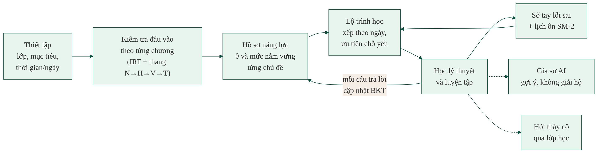{width=15.5cm}

Các hình trong mục này được chụp khi chạy phần mềm với tài khoản thử lớp 9 ngày 26/10/2026[^anhthu].

**Thiết lập.** Học sinh chọn lớp, mục tiêu (ôn giữa kỳ, cuối kỳ, thi vào lớp 10 hay học nâng cao), số phút học mỗi ngày và tự đánh giá mình yếu, trung bình, khá hay giỏi. Mục tiêu quyết định mức nắm vững cần đạt: 70% với ôn giữa kỳ, 85% với thi vào lớp 10.

**Kiểm tra đầu vào theo chương.** Học sinh có thể kiểm tra chương nào đã học trước, không phải làm cả khối một lần. Mỗi câu có đồng hồ từ 90 đến 180 giây, câu càng khó càng được nhiều thời gian. Làm xong một chương, phần mềm cho biết số câu đúng, mức đã vượt qua ở từng chủ đề và năng lực ước lượng θ (Hình 2).

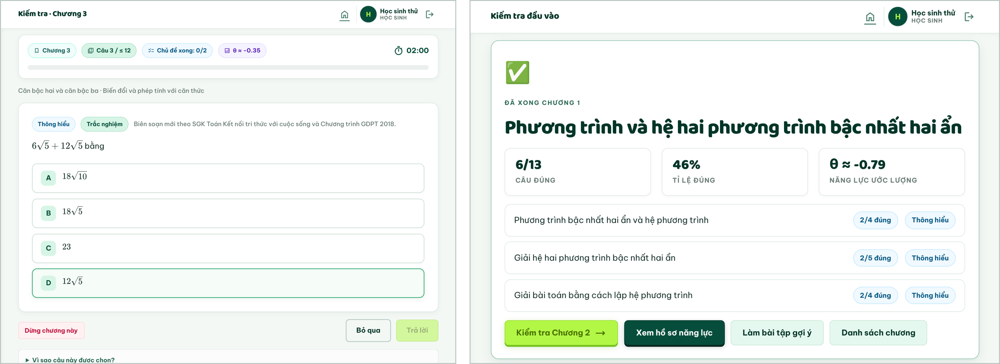{width=15.5cm}

**Hồ sơ năng lực và lộ trình học.** Biểu đồ mạng nhện cho thấy mức nắm vững của từng chương so với đường mục tiêu. Bên cạnh là danh sách "Điểm cần củng cố", xếp theo khoảng cách tới mục tiêu. Phần mềm xếp các chủ đề cần bù vào từng ngày, vừa với số phút học sinh đã chọn. Với tài khoản thử ở Hình 3, có 22 chủ đề cần bù, xếp trong 32 ngày, mỗi ngày 45 phút.

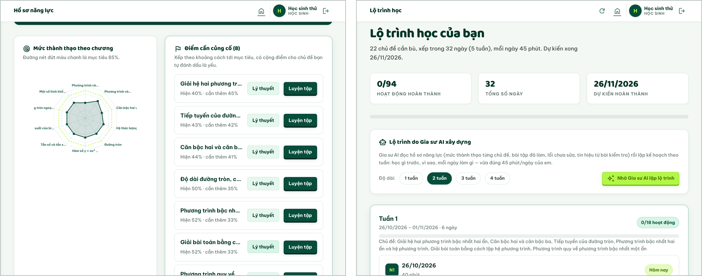{width=15.5cm}

**Việc cần làm hôm nay.** Trang chính có mục "Hôm nay cần làm", tối đa 5 việc: bài ôn đến hạn được đưa lên trước, sau đó mới đến bài mới của lộ trình (Hình 4). Phần mềm còn có điểm kinh nghiệm XP, cấp độ và chuỗi ngày học liên tiếp để tạo hứng thú.

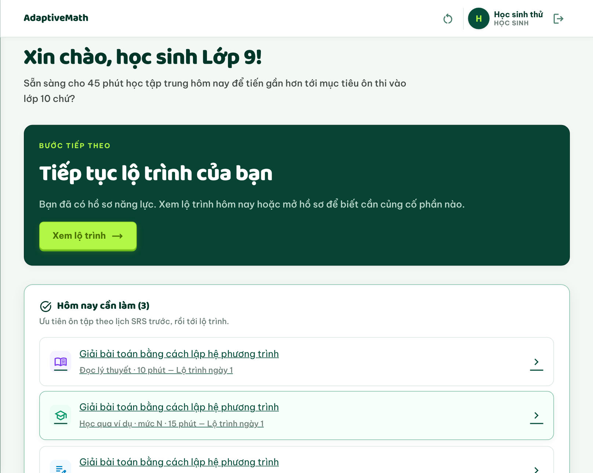{width=10.5cm}

**Luyện tập và sổ lỗi sai.** Mỗi buổi luyện khoảng 5 câu trên một chủ đề. Câu sai trong lúc luyện được ghi vào sổ lỗi kèm đáp án đúng. Câu đó chỉ được tính là đã sửa khi học sinh làm lại đúng (Hình 5).

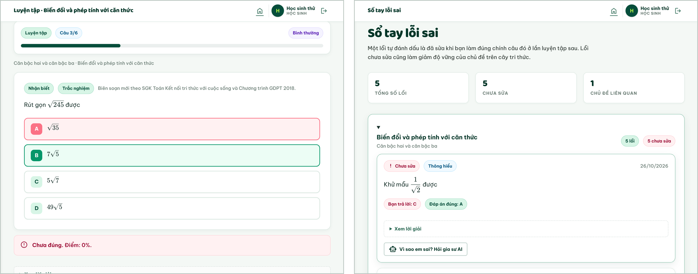{width=15.5cm}

**Bài tập cá nhân hóa và nhiệm vụ số.** Ngoài trắc nghiệm còn có kho bài tập tự luận lấy từ tài liệu ôn tập. Phần mềm gợi ý bài đúng chủ đề và mức học sinh đang cần; học sinh làm ra giấy rồi tự đánh dấu "Làm được" hoặc "Chưa làm được". Nhiệm vụ số là các bài toán gắn với tình huống thực tế, ví dụ kiểm chứng phần trăm giảm giá trên hóa đơn (Hình 6).

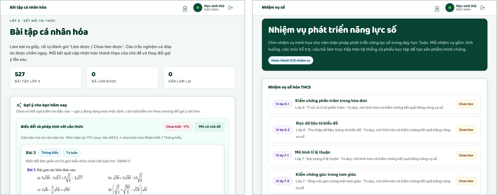{width=15.5cm}

**Gia sư AI.** Học sinh gõ câu hỏi hoặc chụp ảnh đề, chọn một trong các chế độ: vì sao đúng/sai, gợi ý bước đầu, kiểm tra bài làm, lời giải chi tiết, hỏi tự do (Hình 7). Cách hướng dẫn AI được trình bày ở mục 3.6.

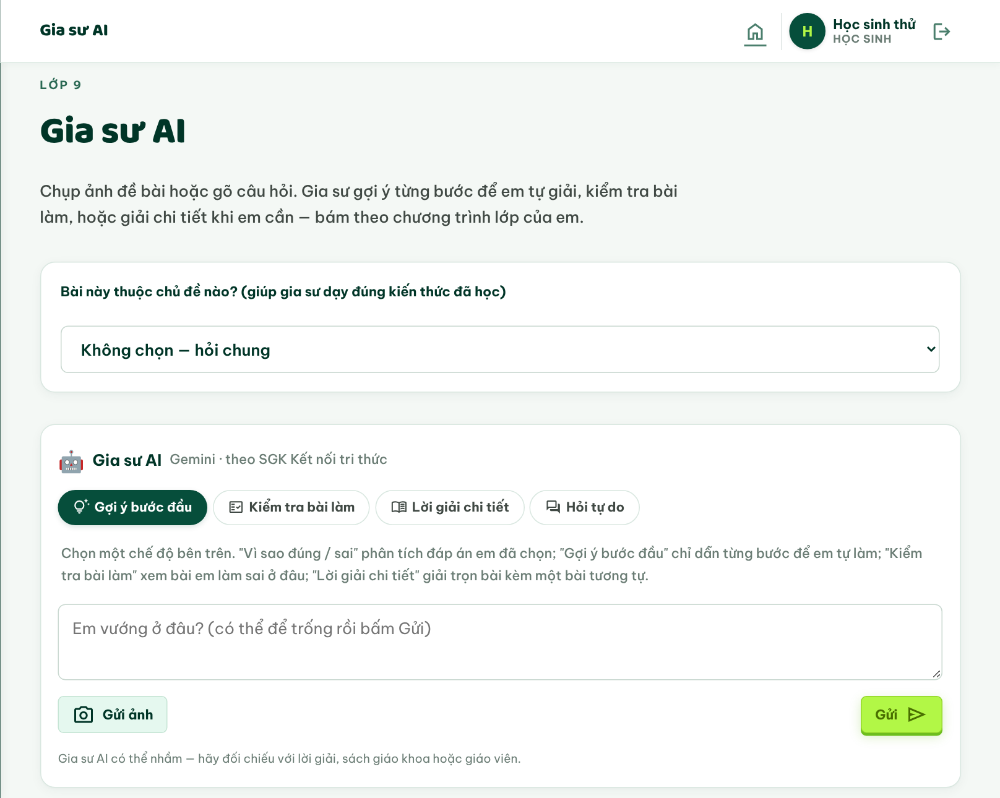{width=10.5cm}

**Lớp học của thầy cô.** Giáo viên tạo lớp và nhận một mã lớp 6 ký tự. Học sinh nhập mã để vào lớp. Giáo viên xem được bảng tóm tắt tiến độ (số chủ đề thành thạo, số câu đã làm, chuỗi ngày học, số lỗi chưa sửa) nhưng không đọc được từng câu trả lời của học sinh. Khi bí, học sinh gửi một yêu cầu trợ giúp, thầy cô trả lời ngay trong trang lớp (Hình 8).

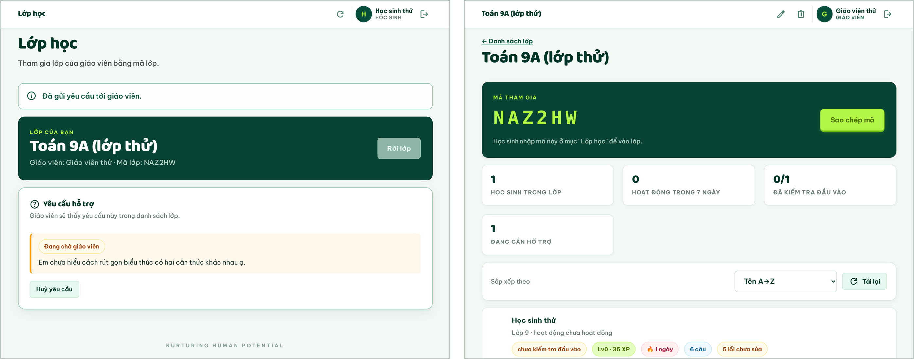{width=15.5cm}

# 3. Cách phần mềm tính toán

## 3.1. Dữ liệu học liệu

Nhóm viết một đoạn mã đếm lại toàn bộ kho dữ liệu trong thư mục `data/` của dự án. Kết quả ở Bảng 2.

**Bảng 2. Kho học liệu của AdaptiveMath (đếm lại ngày 26/10/2026)**

| Khối | Số chủ đề | Số chương | Câu trắc nghiệm | Bài tập tự luyện | Nhiệm vụ số |
|:---|:---:|:---:|:---:|:---:|:---:|
| Lớp 6 | 22 | 9 | 352 | 1.607 | 2 |
| Lớp 7 | 23 | 10 | 368 | 772 | 2 |
| Lớp 8 | 23 | 10 | 368 | 877 | 2 |
| Lớp 9 | 24 | 10 | 384 | 527 | 2 |
| **Tổng** | **92** | **39** | **1.472** | **3.783** | **8** |

Mỗi chủ đề có đúng 16 câu trắc nghiệm, chia đều 4 câu cho mỗi mức Nhận biết (N), Thông hiểu (H), Vận dụng (V), Vận dụng cao (T). Mỗi chủ đề có một bài lý thuyết ngắn kèm ví dụ mẫu. Bài tập tự luyện được tách tự động từ 8 tài liệu ôn tập dạng PDF (hai tập cho mỗi khối) bằng các công cụ trong thư mục `tools/import-exercises`[^pdf]. Mỗi bài giữ ảnh gốc của đề để không mất hình vẽ và công thức.

## 3.2. Ước lượng năng lực bằng IRT

Ý tưởng của Lý thuyết ứng đáp câu hỏi (IRT) là: một học sinh giỏi hơn thì có xác suất làm đúng cao hơn, và câu khó hơn thì xác suất đúng thấp hơn. Phần mềm dùng mô hình ba tham số (3PL):

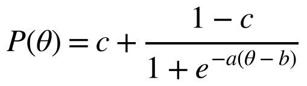{width=6.5cm}

Trong công thức, θ là năng lực của học sinh (0 là trung bình, số dương là trên trung bình). b là độ khó của câu, a cho biết câu phân biệt học sinh giỏi và yếu rõ đến đâu, còn c là xác suất đoán mò đúng. Với câu bốn lựa chọn, c = 0,25. Hiện tại mọi câu dùng a = 1,2, độ khó lấy theo mức: N là −1,5, H là −0,5, V là +0,5, T là +1,5. *Ví dụ:* học sinh trung bình (θ = 0) gặp câu Thông hiểu thì có khoảng 73% khả năng làm đúng.

Sau mỗi câu trả lời, phần mềm tính lại θ từ toàn bộ các câu đã làm. Lúc đầu nhóm dùng cách ước lượng hợp lý cực đại (MLE). Khi học sinh làm đúng hết hoặc sai hết vài câu đầu, θ lập tức bị đẩy ra tận biên ±4. Nhóm chuyển sang ước lượng MAP[^map]. Cách này giả định trước rằng năng lực học sinh thường quanh mức trung bình (phân phối chuẩn, độ lệch 2), nên khi mới có ít câu, kết quả không nhảy quá xa. Mỗi bước tính chỉ được thay đổi θ tối đa 0,75, và θ luôn nằm trong đoạn [−4; 4]. Điểm xuất phát lấy theo phần tự đánh giá: yếu −1,0, trung bình −0,3, khá 0,5, giỏi 1,2.

## 3.3. Chọn câu hỏi theo bậc thang

Cách chọn câu phổ biến trong kiểm tra thích ứng (CAT[^cat]) là lấy câu cho nhiều "thông tin" nhất tại θ hiện tại. Khi thử cách này, nhóm thấy học sinh xuất phát ở θ = 0 hầu như toàn gặp câu Thông hiểu, bỏ qua luôn câu Nhận biết. Như vậy không biết được em đó có nắm khái niệm cơ bản hay không. Nhóm đổi sang cách chọn theo bậc thang cho từng chủ đề:

- Mỗi chủ đề bắt đầu từ mức thấp nhất (N).
- Trả lời đúng thì lên mức kế tiếp (N → H → V → T).
- Trả lời sai thì được thêm một câu cùng mức để xác minh. Sai lần nữa thì dừng chủ đề đó và ghi nhận mức cao nhất đã vượt.
- Chủ đề nào chưa được hỏi câu nào sẽ được ưu tiên, nên mọi chủ đề trong chương đều được hỏi ít nhất một lần.

Bài kiểm tra một chương dừng khi mọi chủ đề đã xét xong, hoặc khi đủ min(50; max(8; 6 × số chủ đề)) câu, hoặc khi hết 25 phút. Chương 3 lớp 9 có 2 chủ đề nên tối đa 12 câu.

## 3.4. Theo dõi mức nắm vững bằng BKT

Năng lực θ là một con số chung. Để biết từng chủ đề, phần mềm dùng mô hình theo dõi tri thức Bayes (BKT). Mô hình coi mỗi chủ đề có hai trạng thái, "đã nắm" hoặc "chưa nắm", và tính xác suất P(L) là học sinh đã nắm. Sau mỗi câu, xác suất được cập nhật bằng công thức Bayes. Ví dụ khi trả lời đúng:

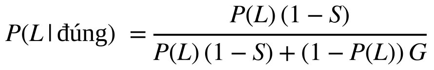{width=9cm}

rồi cộng thêm phần "học được sau lượt làm": P(L) mới = P(L | quan sát) + (1 − P(L | quan sát)) × T.

Các tham số là T = 0,15 (khả năng học được sau mỗi lượt), G = 0,25 (đoán đúng dù chưa nắm), S = 0,10 (sơ suất làm sai dù đã nắm). Chủ đề được coi là thành thạo khi P(L) ≥ 0,85. Hình 9 là ví dụ tính tay: một chủ đề bắt đầu ở 0,10, sau ba câu đúng liên tiếp đã lên 0,93.

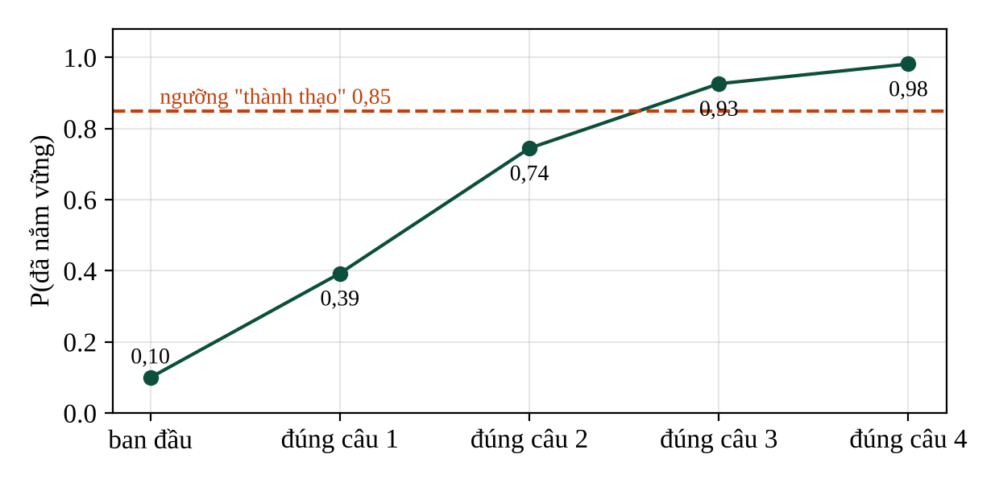{width=11cm}

Ví dụ này cũng cho thấy một điểm yếu: chỉ cần ba câu đúng là đã vượt ngưỡng thành thạo (mục 5 nói thêm).

Trên trang hồ sơ, mức nắm vững của một chủ đề được ghép từ hai nguồn. Một là tỉ lệ đúng thực tế. Hai là xác suất đúng mà mô hình IRT dự đoán từ θ. Độ tin vào tỉ lệ thực tế bằng min(1; số câu đã làm / 5). Như vậy chủ đề mới làm 1–2 câu sẽ dựa nhiều vào dự đoán, còn chủ đề làm từ 5 câu trở lên thì dựa hẳn vào kết quả thật.

## 3.5. Xếp lộ trình và lịch ôn

Mỗi chủ đề chưa đạt mục tiêu được chấm điểm ưu tiên:

*ưu tiên = 0,30 × khoảng thiếu + 0,20 × độ gấp + 0,20 × độ dễ quên + 0,15 × tỉ lệ câu từ đề thi + 0,15 × tự thấy yếu*

"Độ gấp" tăng khi ngày thi đến gần. "Độ dễ quên" lấy từ mức ổn định của chủ đề. Chủ đề có điểm cao được xếp trước. Mỗi chủ đề gồm một buổi lý thuyết khoảng 10 phút và các buổi luyện 15 phút (5 câu) theo từng mức còn thiếu. Lộ trình mỗi ngày có tối đa 2 chủ đề mới, cứ 4 ngày học thì chen một ngày ôn, và không kéo dài quá 90 ngày.

Khi một chủ đề đã thành thạo, thuật toán lặp lại ngắt quãng SM-2 hẹn ngày ôn. Kết quả buổi ôn được đổi ra điểm chất lượng từ 0 đến 5 (đúng từ 90% trở lên được 5, từ 60% được 3). Đạt từ 3 điểm, lần ôn kế tiếp cách 1 ngày, rồi 3 ngày, sau đó nhân với hệ số dễ nhớ EF (bắt đầu 2,5, không nhỏ hơn 1,3), tối đa 180 ngày. Dưới 3 điểm thì quay lại ôn sau 1 ngày và EF giảm 0,2.

## 3.6. Gia sư AI

Gia sư dùng mô hình Google Gemini[^gemini], gọi qua một hàm chạy trên máy chủ[^serverless]. Nhóm không để khóa API trong mã của trang web, vì như thế ai mở trang cũng có thể lấy khóa. Mỗi chế độ có một quy tắc riêng gửi kèm câu hỏi, theo phương pháp gợi mở Socratic[^socratic]:

- *Gợi ý bước đầu:* không được đưa đáp số hay lời giải đầy đủ. Chỉ nêu dạng bài, một công thức then chốt, một bước tiếp theo và kết thúc bằng một câu hỏi gợi mở. Tối đa 80 chữ.
- *Vì sao đúng/sai:* đoán cách nghĩ đã dẫn tới đáp án sai, chỉ ra bước sai, rồi ghi một dòng "Loại lỗi" thuộc 6 nhóm: hiểu sai khái niệm, nhớ sai công thức, tính toán, đọc sai đề, thiếu bước hoặc điều kiện, không có lỗi.
- *Kiểm tra bài làm:* nói bước nào đúng, tìm lỗi sai đầu tiên và cách sửa, không viết lại toàn bài.
- *Lời giải chi tiết:* giải từng bước, ghi rõ quy tắc dùng ở mỗi bước, thêm phần "Lưu ý dễ sai" và một bài tương tự không có đáp án.
- *Hỏi tự do:* trả lời ngắn gọn câu hỏi về khái niệm.

Câu trả lời cho các nút hỏi một chạm về cùng một bài được lưu đệm trên máy chủ (tối đa 30 ngày), nên học sinh sau hỏi lại không tốn thêm lượt gọi AI. Dưới khung chat luôn có dòng nhắc "Gia sư AI có thể nhầm — hãy đối chiếu với lời giải, sách giáo khoa hoặc giáo viên".

## 3.7. Lưu trữ và bảo vệ dữ liệu

Trang web viết bằng HTML, CSS và JavaScript thuần, không cần bước đóng gói. Công thức toán hiển thị bằng KaTeX[^katex]. Tài khoản dùng Firebase Authentication[^auth] (email hoặc Google), dữ liệu lưu trên Cloud Firestore[^firestore]. Quy tắc truy cập (tệp `firestore.rules`) cho phép mỗi học sinh chỉ đọc và ghi dữ liệu của chính mình. Giáo viên chỉ đọc được bảng tóm tắt của học sinh trong lớp mình. Mã lớp được dùng luôn làm tên tài liệu lớp học, nhờ vậy học sinh vào lớp bằng cách mở đúng tài liệu đó, không cần quyền xem danh sách mọi lớp.

# 4. Kết quả kiểm tra

## 4.1. Mô phỏng bài kiểm tra đầu vào

Nhóm chưa có dữ liệu học sinh thật, nên kiểm tra phần ước lượng năng lực bằng mô phỏng[^mophong]. Đoạn mã `tools/mo_phong_cat.js` nạp đúng các tệp `irt.js`, `cat.js` và ngân hàng câu hỏi của phần mềm, rồi tạo các "học sinh ảo" có năng lực thật θ biết trước: −2, −1, 0, 1, 2, mỗi mức 200 em, tổng cộng 1.000 em cho mỗi khối. Học sinh ảo trả lời đúng hay sai theo đúng xác suất của công thức 3PL. Mỗi em làm lần lượt tất cả các chương. Sau đó so θ phần mềm ước lượng được với θ thật (seed 20261026, có thể chạy lại cho ra đúng số liệu này).

**Bảng 3. Kết quả mô phỏng với lớp 9 (10 chương, 384 câu)**

| θ thật | Số câu/chương | Tổng số câu | θ ước lượng TB | RMSE sau 10 chương | RMSE sau chương 1 |
|:---:|:---:|:---:|:---:|:---:|:---:|
| −2 | 9,3 | 93,2 | −1,95 | 0,35 | 0,79 |
| −1 | 10,8 | 108,4 | −0,98 | 0,26 | 0,74 |
| 0 | 11,7 | 117,1 | −0,01 | 0,25 | 0,64 |
| 1 | 11,4 | 113,7 | 1,01 | 0,25 | 0,77 |
| 2 | 10,5 | 105,4 | 2,05 | 0,30 | 0,66 |

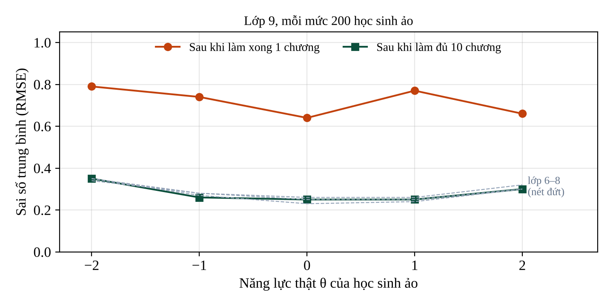{width=12cm}

Từ Bảng 3 và Hình 10, nhóm rút ra ba điều:

- Mỗi chương cần khoảng 9–12 câu, tương đương 15–30 phút. Học sinh ở mức trung bình phải làm nhiều câu nhất, vì các em leo được lên mức cao rồi mới sai.
- Làm đủ các chương thì sai số còn 0,23–0,35 ở cả bốn khối. Lớp 6, 7, 8 cho kết quả gần như lớp 9. Học sinh ở hai đầu (θ = ±2) bị ước lượng kém chính xác hơn, vì ngân hàng không có câu nào khó hơn mức T (b = 1,5) hay dễ hơn mức N (b = −1,5).
- Mới làm một chương thì sai số khoảng 0,6–0,8, tức là chỉ đủ để biết học sinh ở nhóm "yếu", "trung bình" hay "khá". Vì vậy phần mềm ghi rõ những chủ đề chưa kiểm tra là "chưa đánh giá", không tính là 0 điểm.

Cần nói rõ: học sinh ảo trả lời đúng theo mô hình mà phần mềm cũng dùng để chấm, nên đây là trường hợp thuận lợi nhất. Học sinh thật có thể mệt, đọc nhầm đề, hoặc giỏi chương này nhưng yếu chương khác. Sai số thực tế sẽ lớn hơn.

## 4.2. Chạy thử giao diện

Nhóm chạy phần mềm trên máy với một tài khoản thử lớp 9, mục tiêu thi vào lớp 10, 45 phút/ngày. Câu trả lời do một chương trình chọn với tỉ lệ đúng giảm dần theo mức (N cao nhất, T thấp nhất). Sau Chương 1, phần mềm hỏi 13 câu và cho θ ≈ −0,79. Sau bốn chương (55 câu), θ = −0,24 với sai số ±0,35, có 8 chủ đề được đưa vào "Điểm cần củng cố", và lộ trình xếp 22 chủ đề trong 32 ngày (Hình 2, Hình 3).

Lần chạy thử cũng phát hiện một lỗi dữ liệu. Bốn câu của chủ đề *Giải hệ hai phương trình bậc nhất hai ẩn* (mã `9-C1-B3`, các câu q02, q06, q10, q14) bắt đầu bằng "Với cùng hệ trên…", nhưng phần mềm hiển thị từng câu riêng lẻ nên học sinh không thấy hệ phương trình được nhắc tới. Nhóm sẽ sửa bằng cách chép đề bài đầy đủ vào từng câu.

Nhóm và bạn bè tự dùng thử (số người, thời gian, nhận xét chính):

……………………………………………………………………………………………………………

……………………………………………………………………………………………………………

## 4.3. Gia sư AI

Nhóm đã kiểm tra rằng các quy tắc ở mục 3.6 được gửi kèm mỗi câu hỏi (tệp `js/core/tutorPrompt.js`). Để chấm xem AI có làm đúng quy tắc hay không, nhóm hỏi Gia sư ở chế độ "Gợi ý bước đầu" với nhiều bài toán khác nhau và ghi lại kết quả vào Bảng 4.

**Bảng 4. Kiểm tra Gia sư AI ở chế độ "Gợi ý bước đầu"**

| Số bài đã hỏi | Số lần AI lỡ đưa đáp số | Số lần gợi ý sai kiến thức | Nhận xét |
| :---: | :---: | :---: | :--- |
| ……… | ……… | ……… | |

……………………………………………………………………………………………………………

## 4.4. Thử nghiệm với học sinh

Kế hoạch: hai nhóm học sinh có kết quả đầu vào tương đương. Một nhóm dùng AdaptiveMath khoảng 30 phút mỗi ngày trong 4 tuần, nhóm còn lại học như bình thường. Cả hai nhóm làm cùng một bài kiểm tra trước và sau thử nghiệm. Chỉ tiến hành khi nhà trường cho phép và phụ huynh đồng ý; tên học sinh được thay bằng mã số trong mọi bảng dữ liệu.

Thời gian: ……………………… Nhóm thực nghiệm: ……… học sinh. Nhóm đối chứng: ……… học sinh.

**Bảng 5. Kết quả thử nghiệm**

| Chỉ số | Nhóm thực nghiệm | Nhóm đối chứng |
| :--- | :---: | :---: |
| Điểm trung bình bài kiểm tra trước | ……… | ……… |
| Điểm trung bình bài kiểm tra sau | ……… | ……… |
| Tỷ lệ học sinh thấy bớt lo lắng khi học Toán | ……… | ……… |

Nhận xét: ………………………………………………………………………………………………………

……………………………………………………………………………………………………………

# 5. Hạn chế

1. **Tham số câu hỏi chưa được hiệu chuẩn.** Mọi câu dùng chung a = 1,2 và c = 0,25, độ khó chỉ lấy theo nhãn mức. Hai câu cùng nhãn "Vận dụng" thực tế có thể khó dễ rất khác nhau. Muốn hiệu chuẩn cần dữ liệu trả lời của nhiều học sinh thật.
2. **Kết quả mới là mô phỏng.** Mục 4.1 chỉ cho thấy mã tính toán chạy đúng như thiết kế, chưa chứng minh được phần mềm giúp học sinh học tốt hơn.
3. **Ngưỡng thành thạo dễ đạt.** Ba câu đúng liên tiếp đã đưa P(L) từ 0,10 lên 0,93. Nên yêu cầu thêm số câu tối thiểu (ví dụ 5 câu) trước khi công nhận thành thạo.
4. **Chưa có quan hệ "kiến thức tiên quyết" giữa các chủ đề.** Lộ trình hiện xếp theo điểm ưu tiên của từng chủ đề, chưa tự động lùi về chủ đề lớp dưới khi học sinh sai nhiều ở chủ đề lớp trên.
5. **Kiểm tra cả khối khá dài.** Làm đủ các chương lớp 9 mất khoảng 93–117 câu. Học sinh nên làm dần từng chương đã học.
6. **Gia sư AI có thể nhầm**, và cần mạng Internet.
7. **Lỗi dữ liệu** như bốn câu "Với cùng hệ trên…" ở mục 4.2. Ngân hàng câu hỏi cần được thầy cô rà soát thêm.

# 6. Kết luận và hướng phát triển

Nhóm đã xây dựng được một trang web học Toán THCS chạy trên trình duyệt. Trang web có 1.472 câu trắc nghiệm gắn mức độ cho 92 chủ đề của bộ sách *Kết nối tri thức với cuộc sống*, kèm 3.783 bài tập tự luyện. Phần mềm kiểm tra đầu vào theo từng chương bằng bậc thang N → H → V → T, ước lượng năng lực bằng IRT, theo dõi từng chủ đề bằng BKT, rồi tự xếp lộ trình, sổ lỗi sai và lịch ôn. Gia sư AI được hướng dẫn gợi ý từng bước thay vì đưa đáp số. Mô phỏng cho thấy cần khoảng 9–12 câu mỗi chương, và sai số ước lượng giảm còn 0,23–0,35 khi làm đủ các chương.

Về hiệu quả với học sinh: ……………………………………………………………………………………

Các việc nhóm sẽ làm tiếp:

1. Sửa các câu hỏi thiếu ngữ cảnh và nhờ thầy cô dạy Toán rà soát ngân hàng câu hỏi.
2. Thêm điều kiện số câu tối thiểu trước khi công nhận thành thạo.
3. Tổ chức thử nghiệm có đối chứng như mục 4.4, sau đó dùng dữ liệu thật để hiệu chuẩn tham số câu hỏi.
4. Xây sơ đồ kiến thức tiên quyết giữa các chủ đề để lộ trình biết lùi về phần nền.
5. Thêm câu hỏi khó hơn mức T và dễ hơn mức N để đo chính xác hơn ở hai đầu.

# Tài liệu tham khảo

1. Bộ Giáo dục và Đào tạo (2018). *Chương trình giáo dục phổ thông – Môn Toán* (ban hành kèm Thông tư 32/2018/TT-BGDĐT).
2. Bộ Giáo dục và Đào tạo (2025). Quyết định 3588/QĐ-BGDĐT về bộ sách giáo khoa sử dụng thống nhất toàn quốc.
3. Hà Huy Khoái (Tổng chủ biên) và cộng sự. *Toán 6, 7, 8, 9* – bộ sách Kết nối tri thức với cuộc sống. Nhà xuất bản Giáo dục Việt Nam.
4. Lord, F. M. (1980). *Applications of Item Response Theory to Practical Testing Problems*. Lawrence Erlbaum Associates.
5. Baker, F. B. (2001). *The Basics of Item Response Theory* (2nd ed.). ERIC Clearinghouse on Assessment and Evaluation.
6. Corbett, A. T., & Anderson, J. R. (1994). Knowledge tracing: Modeling the acquisition of procedural knowledge. *User Modeling and User-Adapted Interaction*, 4(4), 253–278.
7. Woźniak, P. A. (1990). *Optimization of learning* (luận văn thạc sĩ). Đại học Công nghệ Poznań.
8. Google. Tài liệu Firebase Authentication, Cloud Firestore Security Rules và Gemini API (bản trực tuyến, truy cập tháng 10/2026).

# Phụ lục: minh chứng và thông tin truy cập

| Hạng mục | Thông tin | Ghi chú |
| :--- | :--- | :--- |
| Địa chỉ ứng dụng | …………………………………… | Chỉ ghi nếu Ban tổ chức cho phép |
| Tài khoản học sinh dùng thử | …………………………………… | Không ghi mật khẩu trong bản nộp |
| Tài khoản giáo viên dùng thử | …………………………………… | Không ghi mật khẩu trong bản nộp |
| Video hướng dẫn sử dụng | …………………………………… | Thời lượng: ……… |
| Chương trình mô phỏng | mo_phong_cat.js | Trong thư mục tools |
| Nhật ký nghiên cứu | Phụ lục VIII của hồ sơ | |
| Khai báo sử dụng AI | Phụ lục IX của hồ sơ | |

[^gdpt]: **GDPT 2018:** Chương trình Giáo dục phổ thông ban hành năm 2018, áp dụng cho lớp 6 từ năm học 2021–2022 và cho lớp 9 từ năm học 2024–2025.
[^irt]: **IRT (Item Response Theory – Lý thuyết ứng đáp câu hỏi):** cách đo năng lực dựa trên việc học sinh làm đúng hay sai những câu có độ khó khác nhau, thay vì chỉ đếm số câu đúng.
[^theta]: **θ** (đọc là "tê-ta"): kí hiệu năng lực của học sinh trong IRT. Phần mềm giới hạn θ trong khoảng từ −4 đến 4; 0 là mức trung bình.
[^bkt]: **BKT (Bayesian Knowledge Tracing – Theo dõi tri thức Bayes):** cách ước lượng xác suất học sinh đã nắm một chủ đề, cập nhật lại sau mỗi câu trả lời dựa trên công thức xác suất Bayes.
[^sm2]: **SM-2 (SuperMemo 2):** thuật toán hẹn lịch ôn tập do P. A. Woźniak đề xuất; ôn càng tốt thì lần ôn sau càng cách xa.
[^rmse]: **RMSE (căn bậc hai của trung bình bình phương sai số):** lấy chênh lệch giữa năng lực ước lượng và năng lực thật của từng học sinh ảo, bình phương lên, tính trung bình rồi lấy căn. RMSE càng nhỏ thì ước lượng càng sát.
[^anhthu]: Ảnh được chụp khi chạy mã nguồn trong thư mục dự án trên máy tính, với tài khoản thử và dữ liệu thử; câu trả lời do chương trình chọn, không phải của học sinh thật. "Học sinh thử", "Giáo viên thử" và lớp "Toán 9A (lớp thử)" là tên đặt cho tài khoản thử.
[^pdf]: Nguồn là các tài liệu ôn tập "Cơ bản Toán 6, 7, 8, 9" lưu trong thư mục `data/pdf` của dự án.
[^map]: **MLE** (Maximum Likelihood Estimation) chọn θ khớp nhất với các câu đã làm; **MAP** (Maximum A Posteriori) làm tương tự nhưng có thêm giả định ban đầu rằng θ thường gần 0.
[^cat]: **CAT (Computerized Adaptive Testing – Kiểm tra thích ứng trên máy tính):** bài kiểm tra trong đó câu hỏi sau được chọn dựa trên kết quả các câu trước, nên mỗi học sinh có thể gặp một bộ câu khác nhau.
[^gemini]: **Gemini** là mô hình ngôn ngữ lớn (LLM) của Google, có thể đọc chữ và ảnh rồi trả lời bằng văn bản. Phần mềm thử lần lượt nhiều phiên bản Gemini Flash; phiên bản này không dùng được thì chuyển sang phiên bản khác.
[^serverless]: **Hàm máy chủ (serverless function):** một đoạn mã chạy trên máy chủ của Vercel mỗi khi có yêu cầu. Khóa truy cập Gemini được cất ở đây, người dùng mở trang web không xem được.
[^socratic]: **Phương pháp Socratic:** cách dạy bằng câu hỏi gợi mở, để người học tự tìm ra câu trả lời thay vì được nói sẵn.
[^katex]: **KaTeX:** thư viện hiển thị công thức toán viết theo cú pháp LaTeX trên trang web.
[^auth]: **Firebase Authentication:** dịch vụ đăng nhập của Google, lo phần kiểm tra email, mật khẩu và đăng nhập bằng tài khoản Google.
[^firestore]: **Cloud Firestore:** cơ sở dữ liệu trên mạng của Google; quy tắc trong tệp `firestore.rules` quyết định ai được đọc, ai được ghi.
[^mophong]: **Mô phỏng:** dùng máy tính tạo ra "học sinh ảo" có năng lực biết trước, cho các em làm bài theo đúng xác suất của công thức IRT, rồi xem phần mềm đoán lại năng lực sát đến đâu. Mô phỏng không thay được thực nghiệm với học sinh thật.
